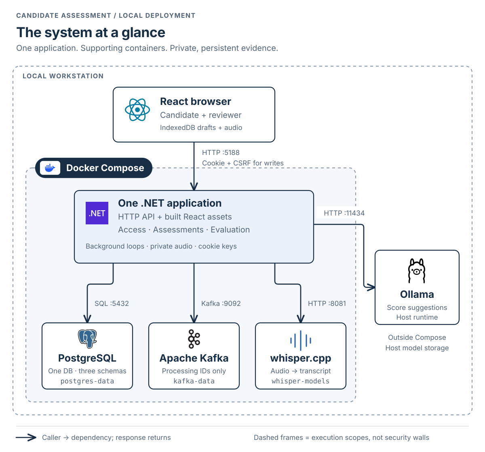
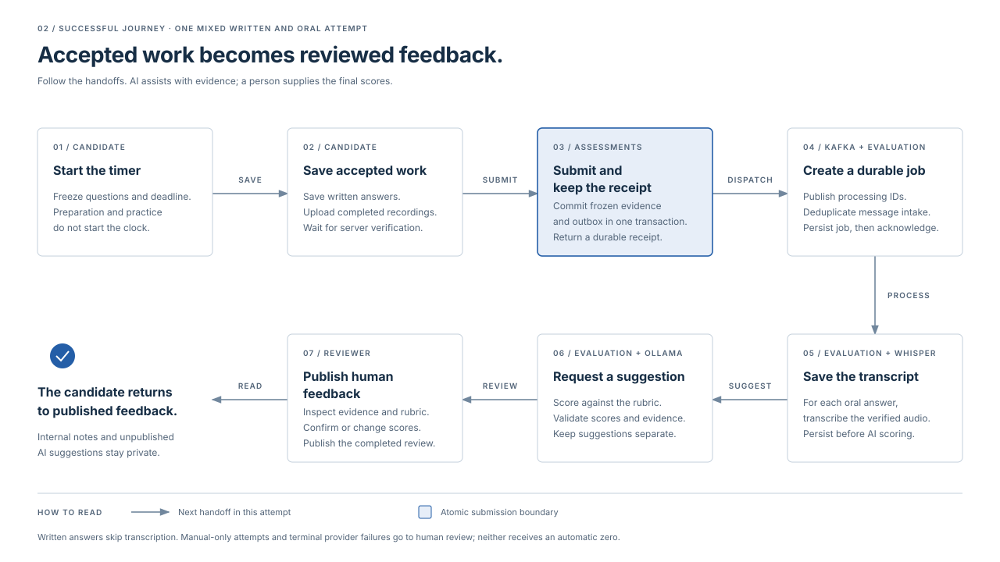
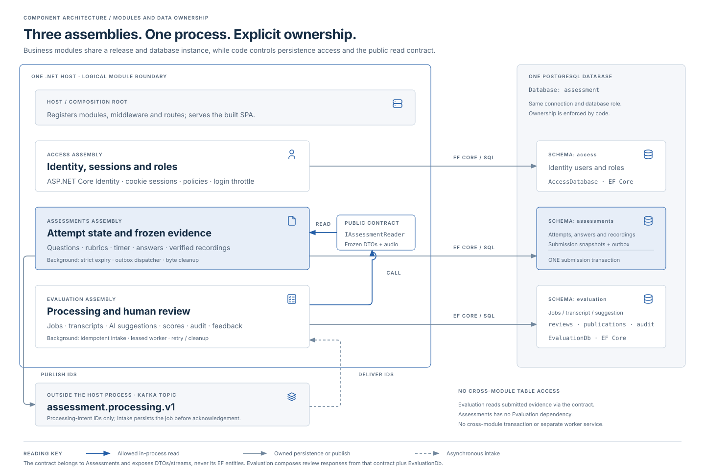
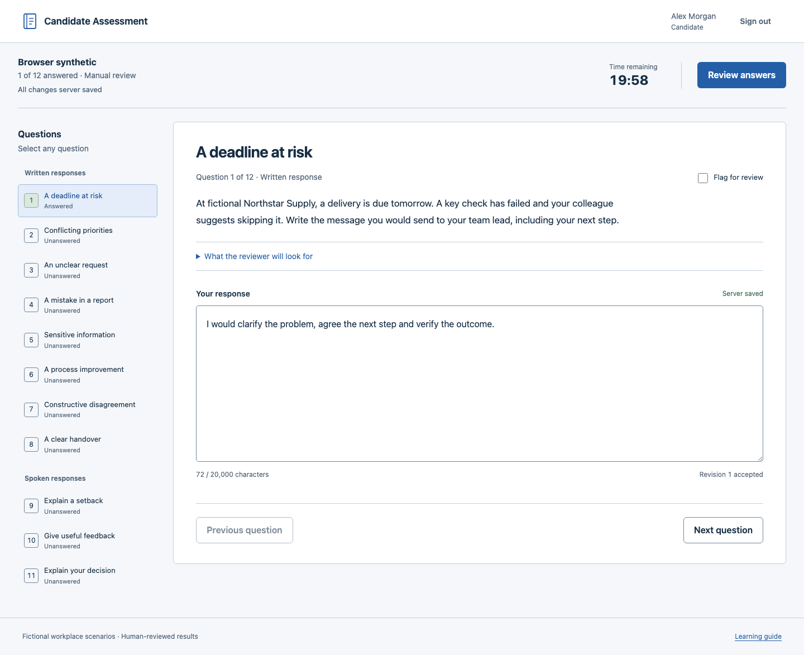
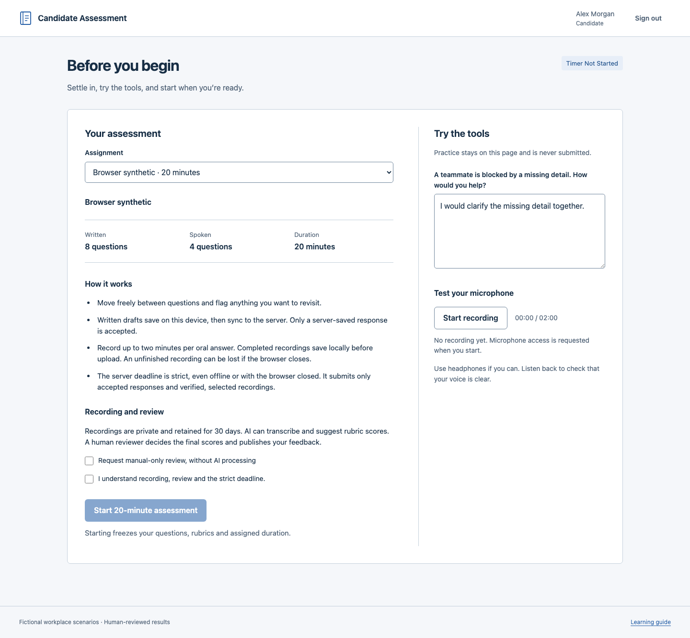
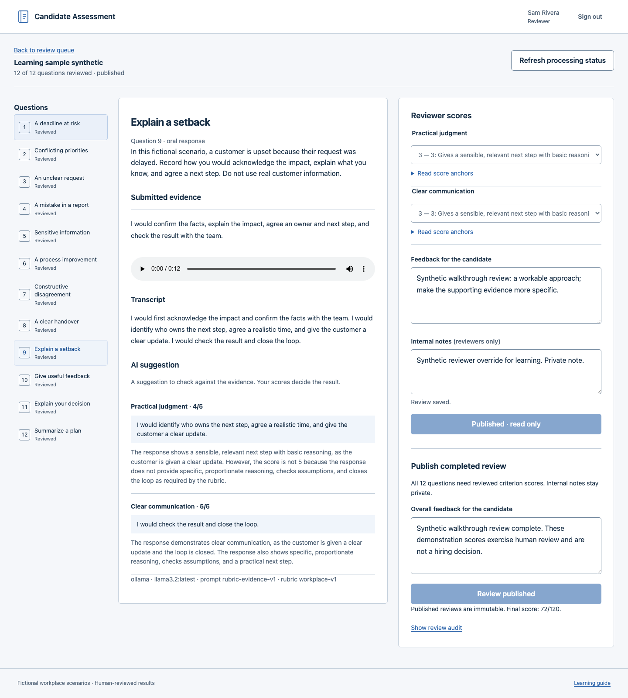

<p align="center">
  
</p>

<h1 align="center">Candidate Assessment</h1>

<p align="center"><strong>Timed written and spoken assessments, with AI assistance and human-reviewed feedback.</strong></p>
<p align="center">Private responses. Reliable processing. Final scores decided by a reviewer.</p>

<p align="center">
  <a href="#run-locally">Run locally</a> ·
  <a href="#assessment-workflow">Workflow</a> ·
  <a href="#system-architecture">Architecture</a> ·
  <a href="docs/how-it-works.md">How it works</a> ·
  <a href="#screenshots">Screenshots</a>
</p>

<p align="center">
  <a href="https://github.com/junrillg/candidate-assessment-lab/actions/workflows/ci.yml"></a>
</p>

Candidate Assessment manages a timed response session from candidate preparation through published feedback. Candidates write answers and record spoken responses; reviewers inspect the evidence, apply rubric criteria and publish final scores.

The app uses **React, .NET, PostgreSQL and Kafka**, with local whisper.cpp transcription and Ollama score suggestions. AI processing is optional. The seeded demonstration contains fictional workplace scenarios: **8 written questions, 4 spoken questions and a 20-minute deadline**, plus a second candidate with 30 minutes.

- Draft recovery, explicit server-save status and revision checks protect accepted answers.
- Recordings are validated, versioned and served through authenticated access.
- A durable receipt separates submission from background processing.
- AI suggestions, human scores and private reviewer notes remain separate.

## System architecture

One application process hosts the API and three business modules. PostgreSQL, Kafka and transcription run in separate containers; Ollama runs on the host. React is served by the application and executes in the browser.

[](docs/diagrams/system-architecture.svg)

[Component and data-ownership diagram](docs/diagrams/module-architecture.svg) · [Engineering architecture](docs/architecture.md) · [Editable model](docs/diagrams/system-architecture.mmd)

## Run locally

### 1. Prepare your tools

Install **Git, Make, Python 3, Docker with Compose, and [Ollama](https://ollama.com/)**. Start Docker and Ollama. Docker builds the frontend and backend; no cloud account is needed.

For development/checks, also install .NET 10 SDK, Node 24/npm, FFmpeg/ffprobe and Terraform. [Tool details](docs/operations.md).

### 2. Clone and start

```sh
git clone https://github.com/junrillg/candidate-assessment-lab.git
cd candidate-assessment-lab
ollama pull llama3.2:latest
make up
```

The first run downloads images and AI models, builds the app and transcription runtime, creates the database schemas and seeds fictional accounts. Whisper’s base model is checksum-verified. Wait for setup to finish; later starts reuse stored data and models.

When startup succeeds, the terminal prints:

```text
Candidate Assessment ready: http://localhost:5188
```

### 3. Sign in

Open **[http://localhost:5188](http://localhost:5188)**. Open `.local/credentials.json` in your local editor and use one of its candidate accounts. That file also contains the reviewer account.

`make up` automatically generates this private file (mode `0600`, ignored by Git). Registration is disabled. Keep passwords out of commits, screenshots and notes.

You should reach **Before you begin** with **Timer not started**. Preparation and microphone practice do not consume assessment time.

## Assessment workflow

[](docs/diagrams/journey.svg)

**Candidate.** Sign in, read the instructions and test written input and microphone playback. Preparation does not start the timer. Before starting, the candidate can select **Request manual-only review, without AI processing**. During the attempt, answers save with explicit status, questions can be flagged, and completed recordings can be played back before submission. **Review answers** shows unanswered questions and upload status. Submission returns a durable receipt and freezes accepted evidence.

**Reviewer.** Open an attempt from the review queue. Inspect each answer or recording with its rubric, transcript and available AI rationale. Save every criterion score for all 12 questions, add overall feedback and publish. The candidate can then read the published scores and feedback; internal notes remain private. Manual-only review uses direct listening. Processing failure allows manual review and never assigns an automatic zero.

**The server deadline is strict, even offline or with the browser closed.** Only accepted answers and verified selected recordings are finalized. Late local drafts remain unsent; unfinished recordings can be lost on interruption.

[How the lifecycle works](docs/how-it-works.md) explains the state transitions, storage boundaries and failure handling. `make sample` creates or reopens a submitted synthetic example for inspection; a reviewer still scores and publishes it.

## Design boundaries

The browser talks to **one .NET application**. Access handles sign-in, Assessments accepts and freezes responses, and Evaluation handles jobs and human review. Each module owns its PostgreSQL schema. Supporting infrastructure provides Kafka, private recordings, transcription and local AI scoring.

[](docs/diagrams/module-architecture.svg)

Submission saves frozen evidence and processing intent together. Kafka carries IDs, never answer text or audio. Evaluation persists jobs and transcripts before requesting AI suggestions. A reviewer decides the final scores and publishes feedback.

[Architecture explanation](docs/architecture.md) · [Editable component model](docs/diagrams/module-architecture.mmd) · [Submission sequence](docs/diagrams/happy-path.svg) · [Illustrated walkthrough](docs/follow-an-assessment.html)

<details>
<summary>Architecture terms</summary>

| Term | Meaning here |
|---|---|
| Modular monolith | Access, Assessments and Evaluation are separate business modules in one backend release |
| Rubric | Scoring criteria with anchored descriptions |
| Revision | Server version used to reject a stale tab’s save |
| Outbox | Processing intent committed with the submission, ready to send when Kafka is available |
| Idempotency | Repeated submissions/messages safely reuse a receipt/job |
| Lease and fence | A bounded job claim that prevents a stale worker overwriting a newer result |

[Reliability guarantees and module source](docs/architecture.md) · [UI design system](DESIGN.md)

</details>

## Screenshots

Real app screens with fictional demonstration data. Select an image to view it at full size.

[](docs/assets/screenshots/candidate-workspace.png)

| Prepare before the timer starts | Review the evidence and rubric |
|---|---|
| [](docs/assets/screenshots/preparation.png) | [](docs/assets/screenshots/reviewer-workspace.png) |

[Recording screen and capture details](docs/assets/screenshots/README.md)

## If something gets stuck

| What you see | What to do next |
|---|---|
| Startup has not reached the ready message | Check Docker, then use `make status` and `make logs`. First-run downloads need network access. |
| Sign-in fails | Use `.local/credentials.json`; check that startup finished seeding. There is no shared default password. |
| A response is only saved locally | Reconnect before the deadline; wait for **Server saved**. Resolve conflicts explicitly. |
| AI processing needs review | Review evidence directly or retry failed processing. Check Ollama and `llama3.2:latest`. |

Stop with `make down`; data, recordings, session keys and models remain. Return with `make up`. Avoid deleting volumes to repair startup.

[Operations](docs/operations.md) covers recovery, backups and 30-day recording retention. [Failure scenarios](docs/failure-drills.md) document offline saves, broker outages, worker interruption and provider failures.

## Checks and further reading

Run these from the repository root, one at a time:

```sh
make help
make test          # module, architecture, adapter and draft checks
make verify        # tests, builds, configuration, Terraform and API integration
make recovery      # provider-outage and interrupted-worker checks
make diagrams      # export editorial figures and render Mermaid to SVG
```

For browser checks: `cd frontend && npm ci && npx playwright install chromium`, then `npm run test:browser` against the running lab. Audio is generated; your microphone is not used.

[How it works](docs/how-it-works.md) · [Architecture and source boundaries](docs/architecture.md) · [Verification evidence](docs/TASK.md)

## Optional cloud profiles

Local Compose is the default runtime. [Azure Singapore](infra/azure/README.md) (`southeastasia`) is the preferred future deployment; [AWS Singapore](infra/aws/README.md) (`ap-southeast-1`) remains available. Both run the same app and supporting processes on one VM, with one failure domain.

[Azure deployment diagram](docs/diagrams/azure.svg) · [Editable Azure diagram](docs/diagrams/azure.mmd) · [Cloud profile comparison](infra/cloud/README.md)

Neither cloud profile has been deployed. Review its access, cost and retained-storage instructions before applying. Only explicit cloud apply commands provision paid cloud resources.

Physical microphone quality, live restore, production capacity, cloud runtime reliability and hiring-score validity require separate evidence. Browser storage can be blocked or exhausted; the app warns and continues online server saves. The seeded deployment uses fictional data; it does not establish suitability for real hiring decisions.
