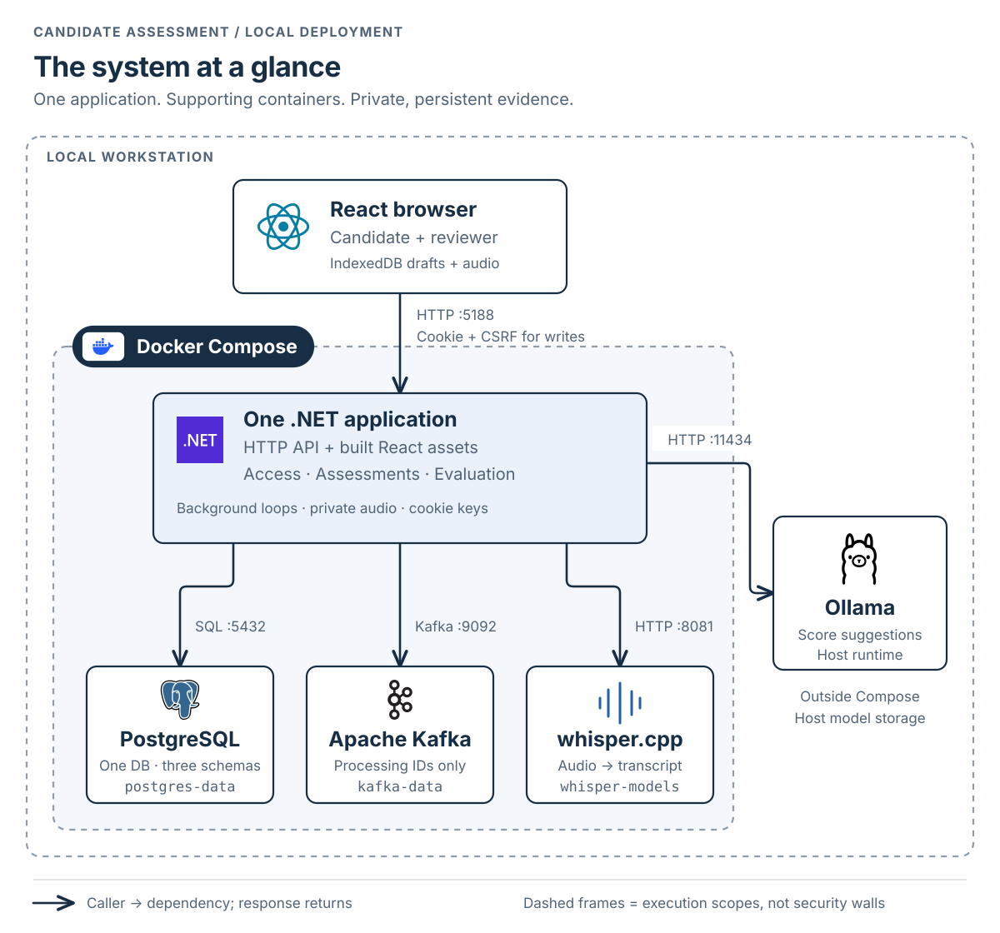
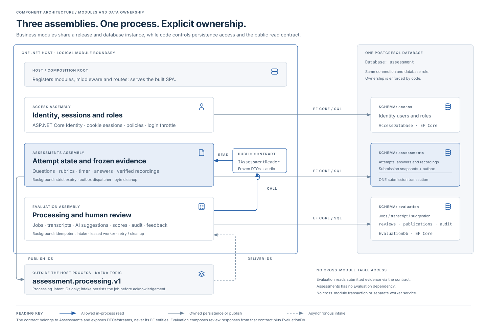

# System architecture

Candidate Assessment is a modular monolith: one .NET process serves the built React application, exposes the HTTP API and runs background services. Access, Assessments and Evaluation are business modules within that process. PostgreSQL, Kafka, transcription and host Ollama are separate supporting runtimes.

The views below describe the **implemented local deployment** and its internal components. They show structure, dependencies and ownership. The [assessment workflow](diagrams/journey.svg) and [submission sequence](diagrams/happy-path.svg) describe execution order separately.

## Runtime and deployment architecture

[Full-size SVG](diagrams/system-architecture.svg) · [Scrollable HTML](diagrams/system-architecture.html) · [Mermaid model](diagrams/system-architecture.mmd) · [Compose source](../compose.yaml)

React executes in the browser; its static assets are built into the .NET image. There is no separate React server in the deployed stack. The application container hosts HTTP endpoints, deadline finalization, outbox dispatch, Kafka intake, evaluation workers and cleanup loops. Those loops share the same process, resources and restart boundary.

PostgreSQL, Kafka and transcription run in their own Compose containers. Ollama runs on the host and is reached through `host.docker.internal`. The Compose network and container boxes describe execution and connectivity; they do not imply mutual authentication or a security boundary between trusted local infrastructure components.

### Interfaces and retained state

These are the Compose defaults; optional port environment variables can override the host mappings.

| Interface | Address / protocol | Purpose |
|---|---|---|
| Browser → application | `http://localhost:5188` → app `8080` | Static React assets and same-origin `/api`; cookie session and CSRF protection |
| Application → PostgreSQL | `postgres:5432` / SQL | One database, three module-owned schemas |
| Application ↔ Kafka | `kafka:9092` / Kafka protocol | Publish processing metadata and consume durable evaluation work |
| Evaluation → transcription | `transcription:8081` / HTTP | Verified oral audio → transcript; no published host port |
| Evaluation → Ollama | `host.docker.internal:11434` / HTTP | Written evidence or saved transcript + rubric → score suggestion |
| Operator → PostgreSQL / Kafka | Loopback `55438:5432` / `19098:9094` | Local inspection; these are not public endpoints |

| Storage | Owner / contents |
|---|---|
| Browser IndexedDB | Device drafts and completed recordings awaiting acceptance |
| `postgres-data` | Identity, assessment evidence, outbox, durable jobs, transcripts, reviews and audit |
| `recordings` | Verified immutable audio bytes, accessed through Assessments |
| `session-keys` | ASP.NET Data Protection keys that preserve cookie/key continuity across restarts |
| `kafka-data` | Broker log data containing processing identifiers and correlation metadata |
| `whisper-models` | Downloaded checksum-verified transcription model |
| Host-managed Ollama storage | Scoring model outside the Compose volume lifecycle |

## Component architecture and data ownership

[Full-size SVG](diagrams/module-architecture.svg) · [Scrollable HTML](diagrams/module-architecture.html) · [Mermaid model](diagrams/module-architecture.mmd)

| Component | Owns | Permitted collaboration |
|---|---|---|
| Host / composition root | Configuration, module registration, routing, shared middleware, static assets and health endpoints | Wires module implementations and maps their endpoints |
| Access | Identity users/roles in `access`; cookie-based sessions | Supplies authentication and authorization to the HTTP boundary |
| Assessments | Questions/rubrics, assignments, timer, answers, recording references, frozen submission and outbox; `assessments` schema | Exposes `IAssessmentReader` returning immutable evidence and authorized recording streams |
| Evaluation | Durable jobs, transcripts, AI suggestions, human reviews, publication and audit; `evaluation` schema | Calls `IAssessmentReader`; combines assessment evidence with its own review data |

Evaluation references the Assessments public contract. Assessments has no Evaluation dependency. Each module uses EF Core directly with an internal context and entities. There are no cross-module table reads or shared persistence entities. The database connection/user is shared, so this ownership is enforced through code boundaries and [architecture tests](../tests/Integration/test_architecture.py), rather than PostgreSQL role segregation.

### Consistency and processing boundaries

- **Assessment transaction:** accepted evidence, the durable receipt and per-question outbox intents commit together. Expiry finalization uses the same submission rules. No Evaluation write joins this transaction.
- **Delivery boundary:** the dispatcher publishes processing IDs and then marks an outbox record published. Delivery may repeat after interruption. Evaluation inserts a job idempotently before acknowledging the valid message; a failed database write remains unacknowledged.
- **Worker boundary:** persisted leases and fences reject stale completion. Oral transcription commits before scoring. Provider timeouts and capped retries lead to explicit human review after terminal failure.
- **Human decision boundary:** AI suggestions remain separate from reviewed scores. Publication requires complete criterion scores, aggregates them in application code and freezes the candidate-visible result.

The [frozen-evidence contract](../src/Assessments/Contracts.cs), [outbox dispatcher](../src/Assessments/AssessmentMaintenance.cs), [Evaluation intake/workers](../src/Evaluation/BackgroundProcessing.cs) and [review endpoints](../src/Evaluation/EvaluationModule.cs) implement these boundaries. There is no cross-module transaction, mediator framework, generic repository, event sourcing, saga or separate read database.

## Access and operational boundaries

Candidates can access their own attempts; reviewer operations require the reviewer role. Recording access checks ownership or reviewer authorization and returns private, non-cached content. Identity uses HttpOnly/Strict cookies, account lockout and login throttling; unsafe API requests require CSRF validation. Data Protection keys are retained separately from evidence.

The local stack uses HTTP and plaintext Kafka on trusted development infrastructure; provider calls do not implement service authentication or mutual TLS. Container placement alone is not a substitute for production transport and network controls. The local deployment has no reverse proxy, load balancer or independent worker service.

`/health/live` checks the HTTP host. `/health/ready` checks PostgreSQL access and required module tables; it does not establish broker or AI-provider readiness. Migration and seeding are explicit one-shot host modes. [Operations](operations.md) documents startup, backup/restore, retention and rollback.

## Runtime scenarios and recovery

The structural diagrams above describe where components run and what they depend on. These views describe what happens during execution:

- [Assessment journey](diagrams/journey.svg): candidate work through published human feedback.
- [Submission sequence](diagrams/happy-path.svg): transaction, dispatch, durable intake and review.
- [Recovery sequence](diagrams/recovery.svg): unavailable dependencies, repeated delivery and interrupted workers.
- [Lifecycle and design notes](how-it-works.md): evidence acceptance, recording verification, processing and review invariants.

## Explicit limits

The local deployment uses a single Kafka broker/controller with replication factor one and a single PostgreSQL instance. HTTP and all background loops share the same application restart boundary. Evaluation defaults to two concurrent job loops, configurable from one to four; the transcription runtime accepts one active request and returns a retryable busy response for others. Broker-log loss also needs explicit reconciliation: published outbox entries are not automatically replayed by the backup/restore path, so restoring PostgreSQL alone does not establish complete processing recovery. It establishes neither production scale nor hiring-score validity. [Docker-local Terraform](../infra/local/README.md) remains the default deployment path.

The preferred future cloud path is [Azure Southeast Asia (Singapore)](../infra/azure/README.md): one Ubuntu VM, the same Compose application and host Ollama, retained managed storage, and an SSH tunnel restricted to one operator address. The [AWS Singapore profile](../infra/aws/README.md) remains an alternative, using ARM64 EC2 and Session Manager. These profiles preserve the modular monolith; neither replaces PostgreSQL, Kafka or the AI adapters with a managed service. Cloud runtime reliability remains unverified because neither profile has been applied.

[Edit Azure Mermaid](diagrams/azure.mmd) · [Azure deployment instructions](../infra/azure/README.md) · [All deployment profiles](../infra/cloud/README.md)

Extract Evaluation into a separate host only after measuring independent scaling, ownership or release needs. Its module boundary makes that a future decision; no microservice implementation is included.

Primary background reading: [Microsoft service boundary tradeoffs](https://learn.microsoft.com/en-us/dotnet/architecture/microservices/multi-container-microservice-net-applications/microservice-application-design), [Fowler: Monolith First](https://martinfowler.com/bliki/MonolithFirst.html), [AWS transactional outbox](https://docs.aws.amazon.com/prescriptive-guidance/latest/cloud-design-patterns/transactional-outbox.html), [ASP.NET Core hosted services](https://learn.microsoft.com/en-us/aspnet/core/fundamentals/host/hosted-services), [whisper.cpp](https://github.com/ggml-org/whisper.cpp).
