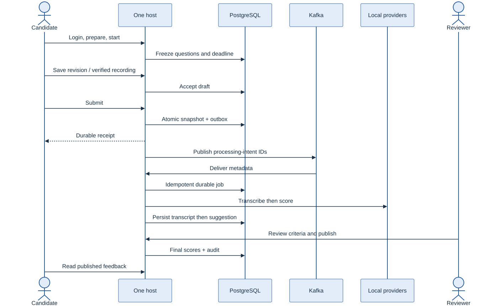

# One application, three business modules

Candidate Assessment is one .NET host with HTTP endpoints and `BackgroundService` loops. React is built into the host. PostgreSQL, Kafka, recording storage, transcription and Ollama support that application; they are not business microservices.

[Edit Mermaid](diagrams/modules.mmd) · [Runtime diagram](diagrams/runtime.svg) · [Runtime source](diagrams/runtime.mmd)

Each module has its own assembly, internal EF context, schema and migration history. Access owns Identity and sessions. Assessments owns assignments, attempts, answers, recording references, frozen submission evidence and publication intent. Evaluation owns durable jobs, transcripts, AI suggestions, human scores and audit. Evaluation reads immutable assessment evidence through `IAssessmentReader`; Assessments has no Evaluation dependency. The host composes modules.

EF Core is used directly in use cases. There is no mediator framework, generic repository, event sourcing, saga, separate read database or cross-module transaction. [Architecture tests](../tests/Integration/test_architecture.py) enforce project-reference direction, internal contexts and SQL schema ownership.

## Reliability in one trace

[Edit Mermaid](diagrams/happy-path.mmd)

Start freezes question/rubric versions and duration. A draft save requires the server revision. Submission locks the attempt and commits immutable per-question evidence and an outbox row in one transaction. The dispatcher can publish more than once; Kafka consumer deduplication uses the processing-intent ID and commits offsets only after durable handling. Messages contain IDs and correlation metadata, never answer bodies or audio.

Evaluation claims bounded work through persisted leases and increments a fence. Completion checks the same fence and unexpired lease. Transcript is committed before scoring, so an interrupted scoring request can reuse transcription. Provider calls have timeouts and bounded retries; terminal failure means needs review, never zero. Application code validates rubric criteria/evidence and aggregates human criterion scores. Only a reviewer can publish.

[Edit Mermaid](diagrams/recovery.mmd)

## Explicit limits

This is a local learning deployment with a single Kafka broker and PostgreSQL instance. It establishes neither production scale nor hiring-score validity. The supplied Terraform profile starts Docker-local resources. The user-selected future cloud path is [one AWS Singapore ARM64 host](../infra/aws/README.md) with retained encrypted storage and SSM access. Terraform is validated without applying resources; cloud runtime reliability remains unverified.

Extract Evaluation into a separate host only after measuring independent scaling, ownership or release needs. Its module boundary makes that a future decision; no microservice implementation is included.

Primary background reading: [Microsoft service boundary tradeoffs](https://learn.microsoft.com/en-us/dotnet/architecture/microservices/multi-container-microservice-net-applications/microservice-application-design), [Fowler: Monolith First](https://martinfowler.com/bliki/MonolithFirst.html), [AWS transactional outbox](https://docs.aws.amazon.com/prescriptive-guidance/latest/cloud-design-patterns/transactional-outbox.html), [ASP.NET Core hosted services](https://learn.microsoft.com/en-us/aspnet/core/fundamentals/host/hosted-services), [whisper.cpp](https://github.com/ggml-org/whisper.cpp).
