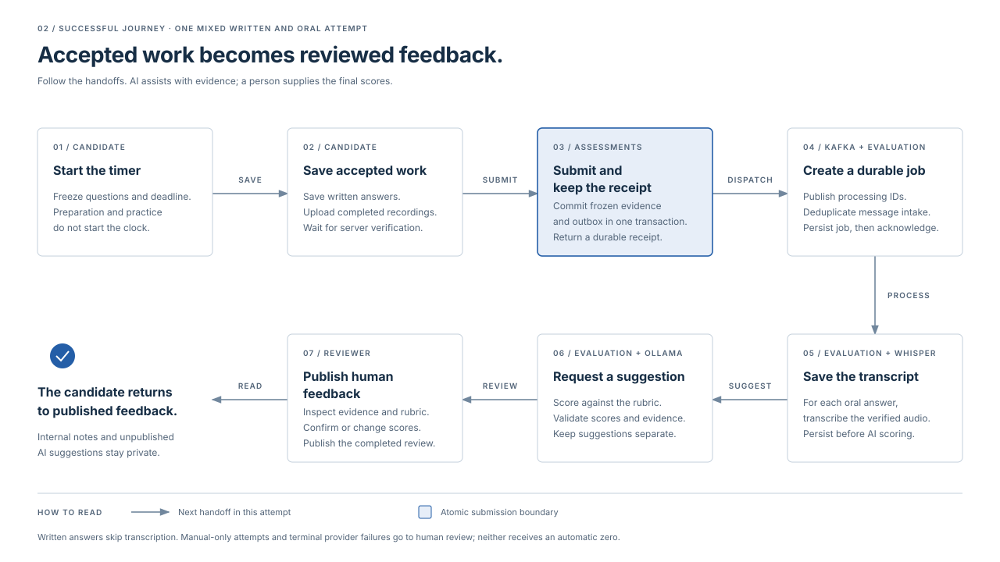
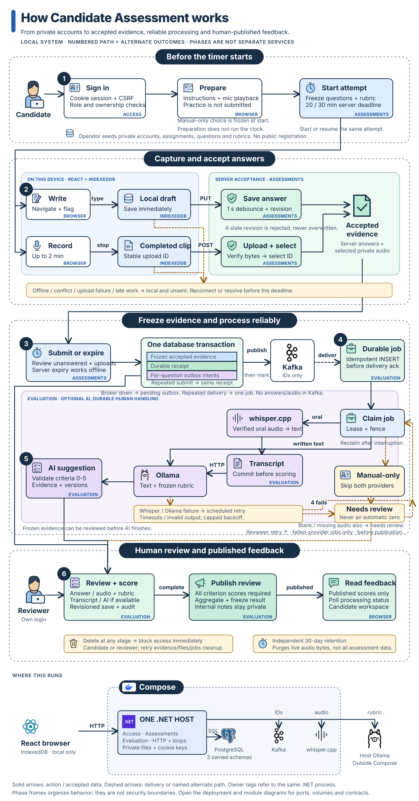

# How Candidate Assessment works

Candidate Assessment separates the response session, automated processing and human review. A submission receipt confirms accepted evidence has been committed; it does not imply transcription, scoring or review has finished. Published feedback contains the reviewer's final scores.

## Assessment lifecycle

| Area | Behavior | Engineering notes |
|---|---|---|
| Sign-in and attempt start | Candidate ownership is checked; starting freezes the question/rubric versions and deadline | [Identity and attempts](flows/attempts.md) |
| Written responses | Device drafts synchronize with explicit server revisions; stale saves are rejected | [Answer saving and recovery](flows/answer-saving.md) |
| Spoken responses | Completed recordings upload as immutable versions; only verified selections enter the submission | [Recording storage and access](flows/recordings.md) |
| Submission | Frozen evidence and processing intent commit together; repeated requests return the same receipt | [Submission and outbox](flows/submission.md) |
| Automated processing | Durable jobs persist transcription before score suggestions and recover with bounded retries | [Evaluation jobs](flows/evaluation.md) |
| Human review | Every criterion receives a human score; publication freezes the feedback visible to the candidate | [Review and publication](flows/review.md) |

The server controls expiry. At the deadline, a background loop finalizes accepted answers and verified selected recordings even if the browser is closed. Device drafts do not guarantee server acceptance or extend the deadline.

AI assistance is an attempt-level choice made before starting. Manual-only review skips transcription and AI scoring. A reviewer can also handle failed processing directly; provider failure never assigns an automatic zero.

## Why one backend

Access, Assessments and Evaluation are separate assemblies inside one .NET host. Each owns its persistence mappings and PostgreSQL schema. Evaluation reads frozen assessment evidence through the Assessments public contract; modules do not read each other's tables. The host combines module responses for the frontend.

This keeps assessment rules, processing and review ownership explicit while retaining one backend release and ordinary in-process calls. Kafka is used for durable processing delivery. The architecture does not require separately deployed business services or a cross-module database transaction.

[Architecture decisions and boundaries](architecture.md) · [Editable overview](diagrams/overview.mmd) · [Submission sequence](diagrams/happy-path.svg) · [Recovery sequence](diagrams/recovery.svg)

## Data and trust boundaries

- The browser's IndexedDB holds local drafts and completed recordings while they synchronize. The interface distinguishes that state from server acceptance.
- Assessments owns assignments, answers, selected recordings, frozen submission snapshots and outbox intents. Recording bytes live in private storage and are served through ownership-checked endpoints.
- Kafka messages contain processing and correlation identifiers, never answer bodies or audio.
- Evaluation owns durable jobs, saved transcripts, AI suggestions, human reviews, publication and audit. AI/provider versions are retained with suggestions.
- Candidates receive only their permitted attempt data and published human feedback. Internal reviewer notes stay private.

## Code map

| Source | Responsibility |
|---|---|
| [Frontend](../frontend/src/) | Session screens, response workspace, local drafts, recording and review interface |
| [Host](../src/Host/Program.cs) | HTTP composition, configuration, module registration and runtime entry points |
| [Access](../src/Access/AccessModule.cs) | Identity, cookie sessions, roles and CSRF protection |
| [Assessments](../src/Assessments/) | Attempt rules, revision saves, media validation, submission and outbox dispatch |
| [Evaluation](../src/Evaluation/) | Job intake, leases, providers, validation, review and publication |
| [Transcription runtime](../infra/transcription/server.py) | Private audio conversion and whisper.cpp transcription |
| [Compose](../compose.yaml) | Local application, database, broker, transcription and persistent volumes |

## Runtime and operational references

[Run locally](../README.md#run-locally) covers startup and private credentials. [Operations](operations.md) covers configuration, health, migrations, backup/restore, retention and rollback. [Failure scenarios](failure-drills.md) describe recoverable outcomes. [Verification evidence](TASK.md) records implemented behavior and the scope of checks.

`make sample` creates or reopens a separate synthetic submitted attempt through the real API, using fictional responses and audio with AI assistance enabled. It preserves the seeded assignment. The command prints the attempt ID and receipt and retains them in `.local/sample.json`; scoring and publication remain reviewer actions.

The optional [illustrated lifecycle view](follow-an-assessment.html) is served locally with `python3 -m http.server 5193 --bind 127.0.0.1 --directory docs`; open [http://localhost:5193/follow-an-assessment.html](http://localhost:5193/follow-an-assessment.html). It describes the system and does not submit assessment responses.

[Azure Singapore](../infra/azure/README.md) is the preferred future cloud profile; [AWS Singapore](../infra/aws/README.md) remains available. Both preserve the same business flow on one host. Neither profile has been deployed; cloud runtime reliability, production capacity and hiring-score validity remain unverified.
